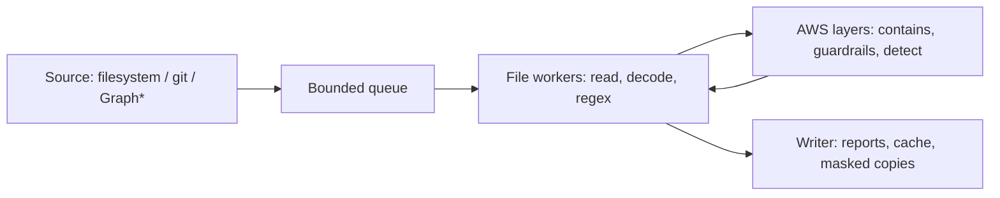

# pii-scan

[](LICENSE)


Find and mask personal data and secrets in files, repositories, and file shares.
Fast local regex validators run on everything; optional AWS layers (Comprehend and Bedrock
Guardrails) add context-aware detection only where it is needed.

## Table of Contents

- [Overview](#overview)
- [Quick Install](#quick-install)
- [Examples](#examples)
- [Features](#features)
- [Usage](#usage)
- [Detection Layers](#detection-layers)
- [Masking](#masking)
- [GitHub Action](#github-action)
- [Documentation](#documentation)
- [Architecture](#architecture)
- [Contributing](#contributing)
- [License](#license)

## Overview

pii-scan is a command-line scanner and GitHub Action for sensitive data: Social Security and
card numbers, passwords, cloud keys, tokens, names, addresses, and the rest of the
[AWS Comprehend PII types](docs/detection-layers.md#entity-types). It is built for two jobs:

- **Guard repositories**: scan the files a pull request changes and fail the build on real
  findings, with annotations and SARIF for code scanning.
- **Audit and sanitize data estates**: walk hundreds of thousands of files across shares, report
  what is where, and write masked copies.

It fails closed: a file that could not be fully analyzed is reported as *not scanned*, never as
clean. Matched values are never printed; outputs show placeholders like `[SSN, 11 chars]`.
It started as a free, open-source alternative to commercial DLP scanners.

## Quick Install

```bash
uv tool install git+https://github.com/ventz/pii-scan
pii-scan --all sample_testing_data.txt
pii-scan --help
```

Requires Python 3.11+ and [uv](https://docs.astral.sh/uv/). For pip, running from a checkout,
and AWS setup, see [Getting Started](docs/getting-started.md).

## Examples

```bash
# Changed files on this branch, including uncommitted work (regex only, nothing leaves the machine)
pii-scan

# Everything under a directory, file, or mounted share
pii-scan --all /mnt/share/finance

# Add AWS detection for names, addresses, and free-text PII
pii-scan --all --aws --region us-east-1 /mnt/share/finance

# AWS detection through a Bedrock guardrail
pii-scan --all --layers regex,contains,guardrails --guardrail-id <id> --region us-east-1 /mnt/share

# Write masked copies
pii-scan --all --mask-out /secure/masked /mnt/share/finance

# Save a report, review it, then mask from it with consistent pseudonyms
pii-scan --all --output jsonl --report findings.jsonl /mnt/share
pii-scan mask --from findings.jsonl --out /secure/masked --style hash

# Large scan you can interrupt and resume
pii-scan --all --workers 48 --cache ~/.cache/pii-scan.db --output jsonl --report findings.jsonl /mnt/share

# CI: fail only on critical findings and write SARIF for code scanning
pii-scan --fail-on critical --output sarif --report pii-scan.sarif

# Accept current findings, then fail only on new ones (needs PII_SCAN_HMAC_KEY)
pii-scan --all --write-baseline baseline.json .
pii-scan --baseline baseline.json

# Add your own patterns
pii-scan --all --custom-regex custom_regex_patterns.json ./data

# Check AWS credentials and layers before a big run
pii-scan doctor --layers contains,detect --region us-east-1
```

## Features

- **Layered detection**: free local regex with validators, then optional
  [ContainsPiiEntities → Guardrails → DetectPiiEntities](docs/detection-layers.md) layers that
  each run only where the previous one found something.
- **Masking**: write masked copies in five styles, including consistent keyed pseudonyms,
  preserving encoding and line endings ([Masking](docs/masking.md)).
- **Built for scale**: streaming pipeline with bounded memory, per-API rate limiting, a resume
  cache, and JSONL output ([Scanning file shares](docs/scanning-shares.md)).
- **Safe on untrusted data**: never follows symlinks or opens FIFOs, bounded reads, hardened
  git, no values in logs ([Security](SECURITY.md)).
- **CI-ready**: changed-files mode, `--fail-on` severity policy, baselines, SARIF, GitHub
  annotations and job summaries ([GitHub Action](docs/github-action.md)).
- **Clear results**: every file ends as clean, findings, not scanned, or skipped, with distinct
  exit codes.

## Usage

See [Examples](#examples) for common scans. Text output is one line per finding, followed by a
summary on stderr:

```text
hr/people.txt:3:6: CRITICAL SSN (regex 1.00): [SSN, 11 chars]
hr/people.txt:7:25: CRITICAL AWS_ACCESS_KEY (regex 1.00): [AWS_ACCESS_KEY, 20 chars]

FAILED: 2 findings at or above high severity.
Files: 5 scanned (0 from cache), 1 with findings, 0 not scanned, 2 skipped.
```

| Exit code | Meaning |
|-----------|---------|
| `0` | Passed: no findings at or above `--fail-on` (default `high`) |
| `1` | Findings at or above `--fail-on` |
| `2` | Usage, configuration, or credential error |
| `3` | Incomplete: some files could not be scanned (`--allow-incomplete` to ignore) |
| `130` | Interrupted |

Every flag and configuration key is in the [Configuration Reference](docs/configuration.md).

## Detection Layers

| Layer | Service | Returns | Relative cost | Role |
|-------|---------|---------|---------------|------|
| `regex` | Local | Exact spans | Free | Secrets and structured PII, always on |
| `contains` | Comprehend ContainsPiiEntities | Types present | Lowest paid | Bulk yes/no screen |
| `guardrails` | Bedrock ApplyGuardrail | Matched text and type | Low | Confirm and locate |
| `detect` | Comprehend DetectPiiEntities | Exact spans and scores | Highest | Authoritative detection |

AWS layers are off by default. `--aws` turns on the recommended `regex,contains,detect` chain;
`--layers` picks any combination. See [Detection Layers](docs/detection-layers.md) for pricing,
quotas, and recommended combinations, and run `pii-scan doctor` to verify an AWS setup.

## Masking

```bash
pii-scan --all --mask-out /secure/masked --mask-style partial /mnt/share
```

`SSN 123-45-6789` becomes `SSN [SSN]` (`label`), `SSN *******6789` (`partial`), or
`SSN [SSN:3f9a1c0b]` (`hash`). Only fully analyzed files are written, originals are never
modified, and each masked file is checked for leftover values. See [Masking](docs/masking.md).

## GitHub Action

```yaml
- uses: actions/checkout@v7
  with:
    fetch-depth: 0
- uses: ventz/pii-scan@v1
  with:
    fail-on: high
```

Inputs, OIDC credentials for AWS layers, and SARIF upload are covered in
[GitHub Action](docs/github-action.md).

## Documentation

| Page | Description |
|------|-------------|
| [Getting Started](docs/getting-started.md) | Install, first scan, and AWS setup |
| [Configuration Reference](docs/configuration.md) | Every CLI flag and configuration key |
| [Detection Layers](docs/detection-layers.md) | Regex, Contains, Guardrails, Detect: costs, quotas, choosing |
| [Masking](docs/masking.md) | Styles, inline and report-driven masking, guarantees |
| [Scanning File Shares](docs/scanning-shares.md) | Large estates: throughput, caching, excludes |
| [GitHub Action](docs/github-action.md) | Workflow setup, inputs, outputs, AWS permissions |
| [Architecture](docs/architecture.md) | Pipeline design and the SharePoint roadmap |
| [Changelog](CHANGELOG.md) | Release history |
| [Security](SECURITY.md) | Data handling and vulnerability reporting |

## Architecture



\*Microsoft Graph (SharePoint and OneDrive) is on the roadmap; see
[Architecture](docs/architecture.md#sharepoint-and-onedrive).

## Contributing

See [CONTRIBUTING.md](CONTRIBUTING.md) for development setup, testing, and ground rules (synthetic
data only).

## License

[MIT](LICENSE) © Ventz Petkov
