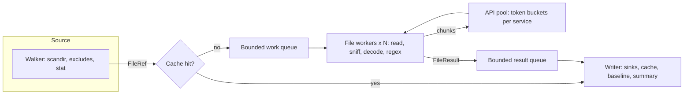

# Architecture

> **Audience**: contributors and anyone evaluating how pii-scan behaves at scale.

- [Pipeline](#pipeline)
- [Components](#components)
- [File outcomes](#file-outcomes)
- [Concurrency](#concurrency)
- [Text handling and offsets](#text-handling-and-offsets)
- [Design decisions](#design-decisions)
- [Roadmap](#roadmap)

## Pipeline

1. A **source** yields `FileRef`s (identity, relative path, size, modification time, change token)
   without holding the tree in memory.
2. The **feeder** records skipped and errored entries directly, checks the cache, and queues the rest.
3. **File workers** read each file once, detect its encoding, run the regex layer, and send chunks
   through the AWS layer chain.
4. A single **writer** thread consumes results in completion order: it streams them to sinks,
   updates the cache, and keeps only counters.

Queues are bounded, so memory use is flat regardless of how many files a run covers.

## Components

| Module | Responsibility |
|--------|----------------|
| `sources/fs.py` | Directory walk with `os.scandir`, excludes, loop and mount guards; hardened bounded reads |
| `sources/git.py` | Changed files from git with hooks, fsmonitor, external diff, submodules, and transports disabled |
| `sniff.py` | Text or binary decision, encoding detection, lossless decode and re-encode |
| `chunking.py` | Byte-bounded overlapping chunks, API-safe text, line and column mapping |
| `detectors/regex.py` | Built-in and custom rules, validators, keyword prefilter |
| `detectors/aws.py` | Contains, Guardrails, and Detect layers; retries, rate limits, error classification, usage |
| `layers.py` | Chains AWS layers across chunks |
| `spans.py` | Deduplicates findings and merges overlaps |
| `masking.py` | Replacement styles, fingerprints, previews, atomic writes |
| `private.py`, `winapi.py` | Owner-only files, link and cloud-placeholder detection, Windows names; Win32 ACLs and no-follow opens |
| `pipeline.py` | Threads, queues, per-file processing, summary |
| `sinks.py`, `console.py` | Machine-readable outputs; human output on stderr |
| `state.py` | Resume cache and baselines |
| `settings.py`, `cli.py` | Configuration and commands |

## File outcomes

Every file ends in exactly one state:

| Status | Meaning | Affects exit code |
|--------|---------|-------------------|
| `clean` | Fully analyzed, nothing found | No |
| `findings` | Fully analyzed, findings reported | `1` if any finding reaches `--fail-on` |
| `not_scanned` | Could not be fully analyzed; the reason is recorded | `3` unless `--allow-incomplete` |
| `excluded` | Skipped on purpose (exclude rule, symlink, special file, binary) | No |

Detectors raise an error instead of returning an empty result, so a failure can't be mistaken
for a clean file. Errors that will repeat for every file (missing credentials, access denied, a
missing guardrail), or 25 AWS failures in a row, stop the run with exit code `2`.

## Concurrency

Threads with bounded queues, chosen for this workload:

- **File I/O** on network shares waits on the network, and threads overlap those waits well.
- **AWS calls** are limited by per-account quotas, not local compute. Token buckets shared by all
  threads enforce `--max-tps-*`. botocore's adaptive retry mode handles throttling, and a
  connection pool sized to the thread count avoids pool contention.
- **Regex** is CPU work. The keyword prefilter skips most rules on most files, which keeps the
  global interpreter lock from becoming the bottleneck for typical data. The per-file function has
  no shared state, so it can move to worker processes if profiling shows the need.

Chunks of one file run concurrently in the API pool; the file's worker waits for all of them, so a
result is always complete or marked not scanned.

## Text handling and offsets

- Files are read as bytes. The encoding is detected from a byte-order mark, then strict UTF-8,
  then Windows-1252 when control characters are rare. NUL bytes without a byte-order mark mean binary.
- UTF-8 is decoded with `surrogateescape`, so undecodable bytes survive a decode and re-encode
  byte for byte. Newlines are never translated.
- Before text is sent to AWS, characters outside the Basic Multilingual Plane and lone surrogates
  are each replaced with one U+FFFD. The text length is unchanged, and code-point offsets equal
  UTF-16 offsets, so offsets are correct whichever unit the service counts in.
- Chunks are at most 90 KB of UTF-8 (the API limit is 100 KB), break at a newline or space when
  possible, and overlap by 1,024 characters. Duplicate findings from the overlap are removed, and
  a hit truncated at a chunk edge is dropped when the neighboring chunk has the whole entity.

## Design decisions

- **Regex runs first and locally.** It is free and exact, and it covers secrets that AWS services
  aren't designed to find.
- **AWS layers are opt-in.** Sending data to a third party and paying per character are decisions
  for the operator, not defaults.
- **Masking writes copies.** In-place rewriting of files on shares risks data loss for little
  benefit over a reviewed copy.
- **No values in any output.** Reports aggregate sensitive data; placeholders and keyed
  fingerprints let people act on findings without creating a new copy of the data.

## Roadmap

### SharePoint and OneDrive

Planned as a native Microsoft Graph source rather than a mounted drive:

- **Why not mount.** Mount tools such as rclone list folders with non-incremental calls, run into
  trouble above roughly 100,000 items per folder, and hide the change tokens needed to detect
  edits between scanning and acting.
- **Enumeration.** `driveItem` delta queries per drive, storing the delta link in the cache so
  re-runs fetch only changes. Graph throttling is budgeted in resource units per app per tenant,
  and `Retry-After` must be honored.
- **Identity.** `FileRef` already carries a source name and change token, so the cache and reports
  work unchanged with Graph item IDs and eTags.

### Labeling

Applying sensitivity labels through Graph (`assignSensitivityLabel`) is a protected, metered API:
about $0.00185 per call, limited to 100 calls per 5 minutes per tenant (about 28,800 files a
day). For bulk labeling of content already in Microsoft 365, Microsoft Purview auto-labeling
(E5-level licensing, up to 100,000 files a day) is usually the better fit. pii-scan would then
produce the findings and label recommendations, and apply labels through Graph only for targeted
cases.

### Other planned work

- Text extraction for Office and PDF files in sandboxed subprocesses with time and memory limits.
- Packing many small files into one `ContainsPiiEntities` request, with bisection on positives,
  to raise screen throughput under the default quota.
- A local NER layer (for example Presidio or a GLiNER PII model) as a free screen for free-text PII.
